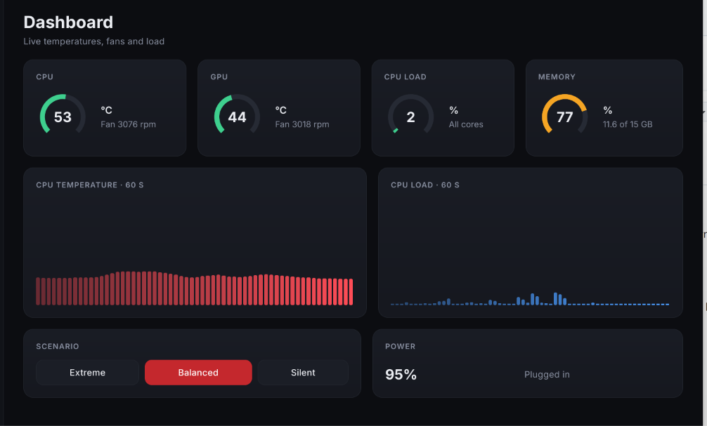
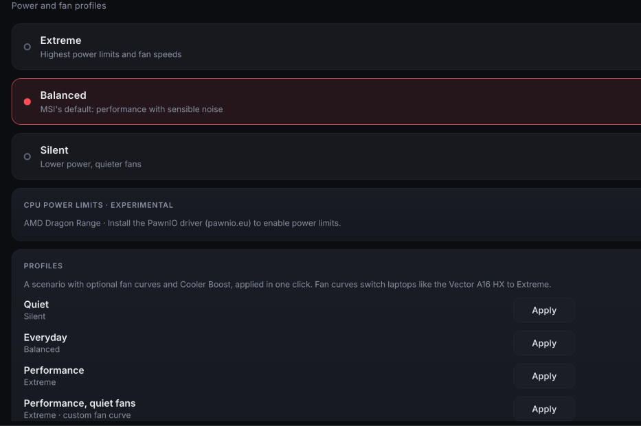
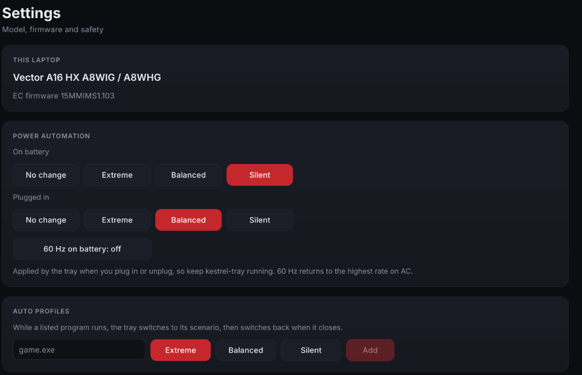
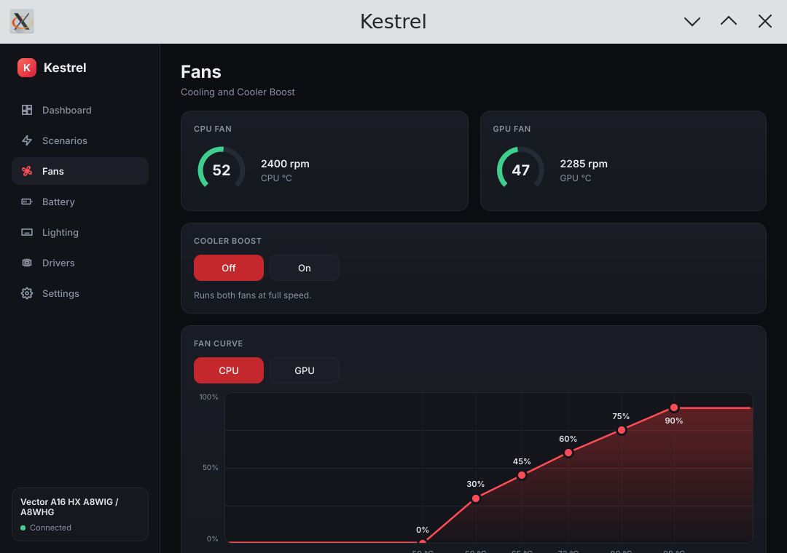

# Kestrel

Lightweight open-source control center for MSI laptops (and, experimentally, GIGABYTE AORUS/AERO): scenarios, fans, battery, keyboard
lighting and monitoring. Native Rust + Slint, no .NET, no WebView. Budget: under 50 MB RAM with
every window open.

## Screenshots

| Dashboard | Scenarios and profiles |
|---|---|
|  |  |
| **Settings and automation** | **Fan curve editor** |
|  |  |

## Install

Step-by-step guide (download, running PowerShell as administrator, first run, undo): [docs/INSTALL.md](docs/INSTALL.md).

## Processes

| Binary | Role | Runs |
|---|---|---|
| `kestrel-svc` | Only process that touches hardware (MSI ACPI-WMI EC, GIGABYTE `GB_WMIACPI`). Sensors, scenarios, journal. | Windows service, LocalSystem |
| `kestrel-tray` | Tray icon: scenario menu, Cooler Boost, opens the window. Plain Win32. | Per user, at login |
| `kestrel-ui` | Main window. Exits fully when closed. | On demand |
| `kestrel-updater` | Signed GitHub Releases updates (Ed25519 manifest + SHA-256). | Library + `kestrel-sign` release tool |

They talk over a versioned, length-prefixed JSON protocol on the `\\.\pipe\kestrel-svc` named pipe
(admins + interactive users only, remote clients rejected).

## EC safety

- The firmware ID picks the register map. Unknown firmware is read-only.
- Maps from msi-ec (`models/ec`) are experimental and read-only unless opted in per firmware in
  `%ProgramData%\Kestrel\settings.json` (`{"allow_experimental": ["14C1EMS1.1"]}`).
- Maps confirmed on owner hardware live in `models/verified` (e.g. Vector A16 HX A8WIG/A8WHG).
- Before a write the current value must be one the map expects; the original is journaled; the
  value is read back and rolled back if it did not stick. See [docs/HARDWARE.md](docs/HARDWARE.md).

## Build

```sh
cargo test --workspace
cargo build --release --workspace          # on Windows
kestrel-svc install                         # admin: registers and starts the service
```

Development without hardware: `kestrel-svc --mock 15MMIMS1.103` (MSI) or `kestrel-svc --mock gigabyte`, then run `kestrel-ui`.
On Linux, install `libfontconfig1-dev libxkbcommon-dev` first.

## Releases

Tag `vX.Y.Z`. The release workflow signs `manifest.json` with the `KESTREL_SIGNING_KEY` secret
(64 hex chars, Ed25519 seed) and embeds `KESTREL_UPDATE_PUBKEY` (repository variable) in the build.
Builds without a key refuse to install updates.

## License

CPU power limits use the [PawnIO](https://github.com/namazso/PawnIO) driver; the `RyzenSMU` and `IntelMSR` modules in `crates/kestrel-svc/pawnio/` come from [PawnIO.Modules](https://github.com/namazso/PawnIO.Modules) 0.2.12 (LGPL-2.1). SMU message IDs and mailbox addresses follow [RyzenAdj](https://github.com/FlyGoat/RyzenAdj).


GPL-3.0-or-later. Register maps derive from [msi-ec](https://github.com/BeardOverflow/msi-ec)
(GPL-2.0-or-later) and GhostDeck owner reports (GPL-3.0).
